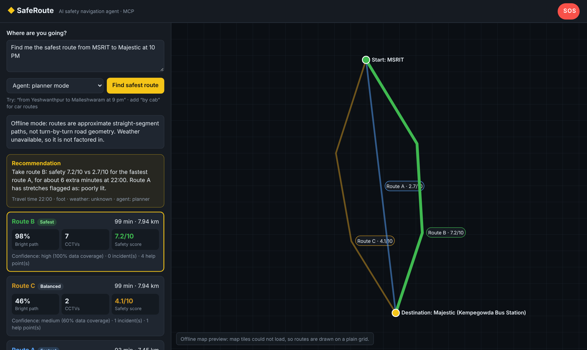
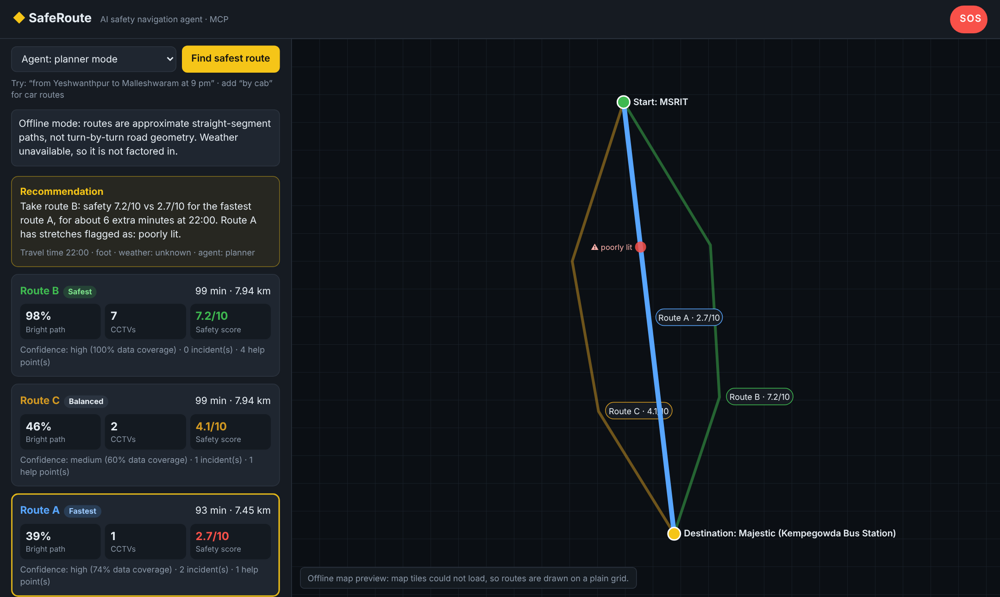
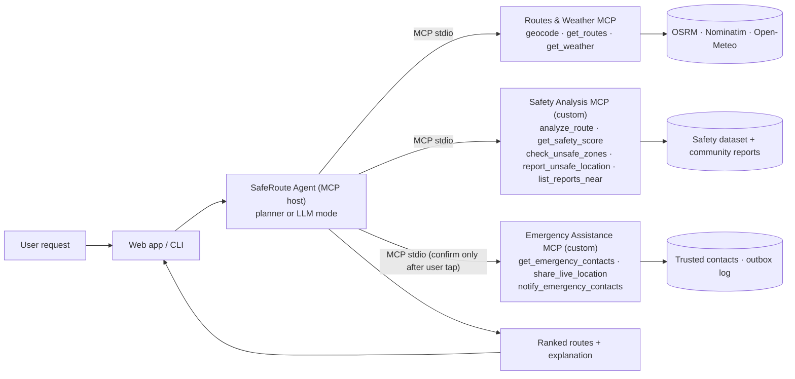
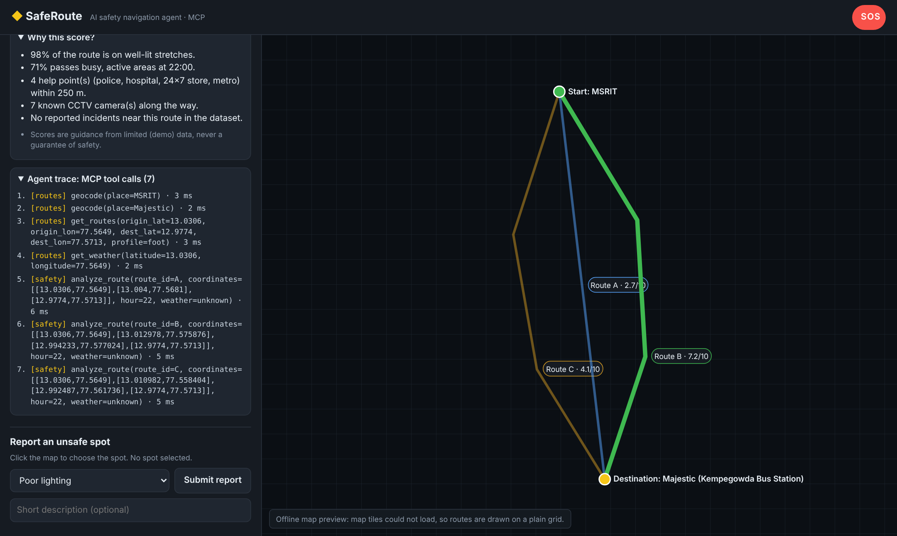
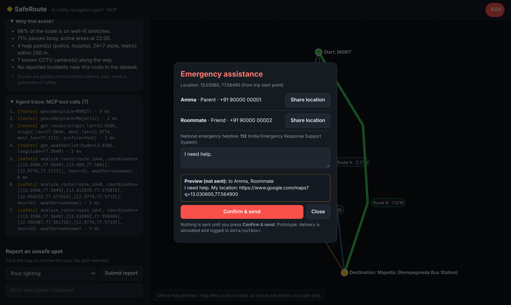
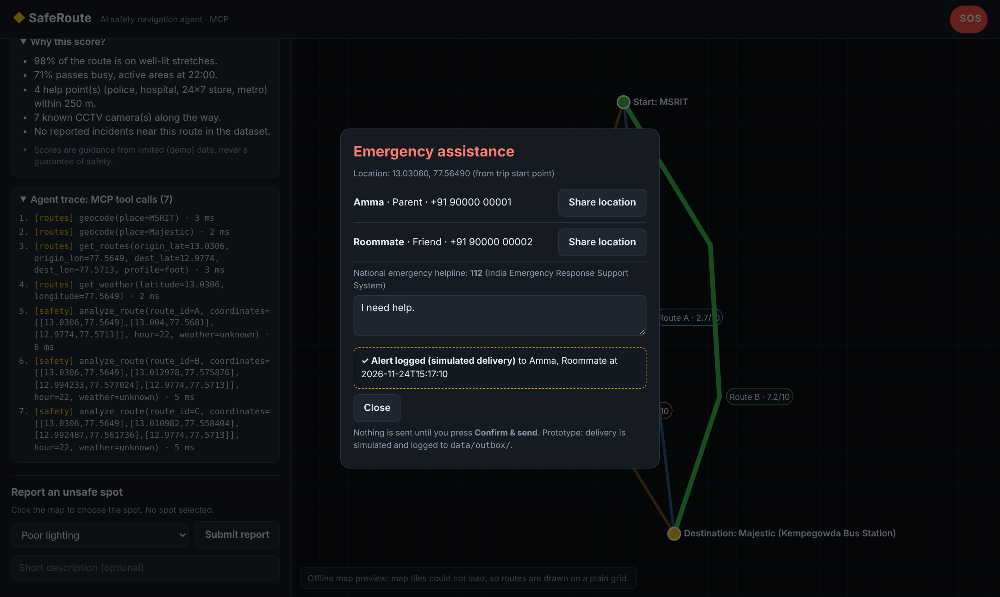

# SafeRoute Agent: AI-Powered Personal Safety Navigation

> **wHACKiest 2026 · Track 1: "Make MCP Matter — Less Magic, More Utility."**
> An MCP-powered agent that finds the **safest** route, not just the shortest, explains *why*, and puts an SOS one tap away.



---

## The problem

Map apps optimise for **time and distance**. When a student leaves college at 10 PM, the real question is different:
*"Which way home is safest right now?"* Today that means guessing: Is this stretch lit? Is it deserted at night? Has anything happened here? Answering it takes several apps and some local knowledge, and nothing explains the trade-off between a faster route and a safer one.

## Our solution

**SafeRoute Agent** takes a plain-English request such as

```text
Find me the safest route from MSRIT to Majestic at 10 PM
```

and the agent, working **only through MCP tools**:

1. geocodes the start and destination (**Routes & Weather MCP**),
2. fetches up to three alternative routes and the current weather,
3. scores **every** route with our custom **Safety Analysis MCP**: lighting, how busy the area is at that hour, help points (police, hospital, 24×7 store, metro), CCTV, reported incidents and weather,
4. ranks the routes (**Safest / Balanced / Fastest**) and explains the trade-off, e.g. *"Take route B: safety 7.2/10 vs 2.7/10 for the fastest route A, for about 6 extra minutes."*

Safety actions go through our custom **Emergency Assistance MCP**, and they are **controlled**: nothing is sent unless the user explicitly taps **Confirm & send**.

### Key features (all implemented in this repository)

| Feature | What it does |
|---|---|
| Safety-based routing | Compares alternative routes on a 0–10 safety score, not just distance |
| Explainable score | Every score lists its reasons, a **data-coverage %** and a confidence level, and never claims a route is "100% safe" |
| Night awareness | Lighting and late-night activity weigh more after 7 PM; daylight ignores lighting |
| Caution spots | Poorly lit, isolated or incident-prone stretches are marked on the map |
| Community reporting | Users report unsafe spots, and reports immediately lower scores for routes passing within 80 m |
| SOS with confirmation | Preview → explicit confirm → alert to trusted contacts with a Google Maps link (**delivery is simulated** in this prototype) |
| Transparent agent | The UI shows every MCP tool call the agent made (the "agent trace") |
| Two agent modes | **Planner mode** (deterministic, no API key) and optional **LLM mode**, where any OpenAI-compatible model picks the tools |



---

## Architecture



Full-size diagram: [`docs/architecture.png`](docs/architecture.png) · Pitch deck: [`docs/presentation/ThinFreshers_Track1.pdf`](docs/presentation/ThinFreshers_Track1.pdf) · Video script: [`docs/video-script.md`](docs/video-script.md)

**Three MCP servers, eleven tools.** The agent never imports server code; it discovers tools with `list_tools` and calls them with `call_tool` over stdio, the same way any MCP-compatible assistant would.

| MCP server | Built by us? | Tools |
|---|---|---|
| `servers/routes_mcp.py`: Routes & Weather | Wrapper over open services | `geocode`, `get_routes`, `get_weather` |
| `servers/safety_mcp.py`: Safety Analysis | **Custom (core innovation)** | `analyze_route`, `get_safety_score`, `check_unsafe_zones`, `report_unsafe_location`, `list_reports_near` |
| `servers/emergency_mcp.py`: Emergency Assistance | **Custom** | `get_emergency_contacts`, `share_live_location`, `notify_emergency_contacts` |

### How the safety score works

Each route is sampled every 50 m. For each sample we check the safety dataset, then combine the results:

| Factor | Night weight | Day weight |
|---|---|---|
| Lighting (well-lit share; unknown counts as neutral) | 35% | 25% (full marks in daylight) |
| Activity (busy vs isolated *at that hour*) | 25% | 30% |
| Help points within 250 m (per km) | 20% | 25% |
| CCTV within 60 m (per km) | 20% | 20% |

Penalties are then subtracted: reported incidents within 80 m (up to −3 at night, −2 by day) and rain/fog (−0.5 at night, −0.3 by day).
The result is a score out of 10 plus the **reasons**, **caution segments** and **data coverage** (high ≥ 60%, medium ≥ 30%, otherwise low).

### Controlled by design

* `share_live_location` and `notify_emergency_contacts` return a **preview** with status `confirmation_required` unless `confirm=true`.
* In LLM mode, these two tools are **not offered to the model at all**. Only the user's tap in the app can send an alert.
* The LLM loop is capped at 10 tool rounds.

---

## Honest status (what is real vs. prototype)

| Part | Status |
|---|---|
| 3 MCP servers, agent, web app, CLI, tests | ✅ Working (13 automated tests, including an end-to-end run through real MCP stdio servers) |
| Live routing / geocoding / weather | ✅ Implemented with public OpenStreetMap OSRM, Nominatim and Open-Meteo (internet needed). If they are unreachable, the app **says so** and falls back to approximate offline routes |
| Safety dataset | ⚠️ **Synthetic demo data** (`data/safety_data_bengaluru_sample.json`, generated by `scripts/generate_sample_data.py`), built around the MSRIT → Majestic demo. **Not real crime/lighting/CCTV data.** Real data sources are future work |
| SOS delivery | ⚠️ **Simulated**: confirmed alerts are logged to `data/outbox/sent_alerts.jsonl`, not sent as SMS |
| LLM mode | ✅ Implemented for OpenAI-compatible endpoints; verified against a mock endpoint. Needs your own API key to use with a real model |
| Screenshots in this README | Taken from the running app in **offline mode** (map tiles unavailable, so routes are drawn on the built-in grid preview) |

---

## Quick start

**Requirements:** Python **3.10+** and internet for live routes and map tiles. Offline mode needs no internet.

### Windows (PowerShell)

```powershell
git clone https://github.com/bhavayraj/saferoute-agent.git
cd saferoute-agent
py -m venv .venv
.venv\Scripts\Activate.ps1
pip install -r requirements.txt
python -m web.app
```

### macOS / Linux

```bash
git clone https://github.com/bhavayraj/saferoute-agent.git
cd saferoute-agent
python3 -m venv .venv
source .venv/bin/activate
pip install -r requirements.txt
python -m web.app
```

Then open **http://127.0.0.1:8000** and press **Find safest route**.

> On Windows, if PowerShell blocks `Activate.ps1`, run `Set-ExecutionPolicy -Scope Process Bypass` first, or use `.venv\Scripts\activate.bat` in Command Prompt.

### Command line

```bash
python -m agent.cli "Find me the safest route from MSRIT to Majestic at 10 PM"
python -m agent.cli --tools        # list all 11 MCP tools
python -m agent.cli --json "from Yeshwanthpur to Malleshwaram at 9 pm by cab"
```

### Settings (environment variables)

| Variable | Default | Meaning |
|---|---|---|
| `SAFEROUTE_DATA_MODE` | `auto` | `auto` = live services, falling back to offline if unreachable; `offline` = no internet at all (reproduces the demo exactly) |
| `LLM_BASE_URL` | – | OpenAI-compatible endpoint, e.g. `https://generativelanguage.googleapis.com/v1beta/openai` (Google Gemini) |
| `LLM_MODEL` | – | e.g. `gemini-2.0-flash` |
| `LLM_API_KEY` | – | Your key for that endpoint |

Windows PowerShell: `$env:SAFEROUTE_DATA_MODE="offline"` · macOS/Linux: `export SAFEROUTE_DATA_MODE=offline`.
When `LLM_BASE_URL` and `LLM_MODEL` are set, the web app enables **LLM mode** in the agent selector, and the CLI accepts `--llm`.

### Your trusted contacts

On first run `data/emergency_contacts.example.json` is copied to `data/emergency_contacts.json` (git-ignored). Edit that file with your own contacts.

### Run the tests

```bash
python -m unittest discover -s tests -v
```

---

## Project structure

```text
saferoute-agent/
├── agent/
│   ├── mcp_host.py        # starts the 3 MCP servers (stdio) and calls their tools
│   ├── planner.py         # request parsing, deterministic plan, ranking, explanation
│   ├── llm_agent.py       # optional LLM tool-calling loop (OpenAI-compatible)
│   └── cli.py             # command-line interface
├── servers/
│   ├── routes_mcp.py      # Routes & Weather MCP
│   ├── safety_mcp.py      # Safety Analysis MCP (custom)
│   ├── emergency_mcp.py   # Emergency Assistance MCP (custom)
│   └── geo.py             # distance / sampling helpers
├── web/
│   ├── app.py             # Starlette API + static site
│   └── static/            # index.html, app.js, style.css
├── data/
│   ├── places_bengaluru.json                # offline gazetteer
│   ├── safety_data_bengaluru_sample.json    # SYNTHETIC demo safety data
│   └── emergency_contacts.example.json
├── scripts/generate_sample_data.py
├── tests/test_saferoute.py
├── docs/
│   ├── architecture.png / architecture.mmd
│   ├── screenshots/
│   ├── presentation/      # pitch deck (PPTX + PDF)
│   └── video-script.md    # video pitch script
├── requirements.txt
└── LICENSE (MIT)
```

## Use the MCP servers from any MCP client

Each server is a standard stdio MCP server, so other MCP clients can use it too. Run the commands from the repository folder:

```json
{
  "mcpServers": {
    "saferoute-safety":    { "command": "python", "args": ["-m", "servers.safety_mcp"],    "cwd": "/path/to/saferoute-agent" },
    "saferoute-routes":    { "command": "python", "args": ["-m", "servers.routes_mcp"],    "cwd": "/path/to/saferoute-agent" },
    "saferoute-emergency": { "command": "python", "args": ["-m", "servers.emergency_mcp"], "cwd": "/path/to/saferoute-agent" }
  }
}
```

## Roadmap (planned for hack day, not built yet)

* Real safety data: open city data, streetlight records and verified community reports in place of the synthetic set
* Real SOS delivery through an SMS/WhatsApp gateway, plus live location updates during the trip
* Dynamic rerouting while travelling when new reports or weather alerts arrive
* **ElevenLabs** voice: hands-free spoken guidance and a voice-triggered SOS
* **AWS** deployment: hosted MCP servers and API so the app runs on phones without a laptop

## More screenshots

| MCP agent trace | SOS: preview before sending | SOS: after explicit confirmation |
|---|---|---|
|  |  |  |

---

**Team Thin freshers (Team ID a507cce1):** Bhavayraj Singhal (Lead) · Avi Sinha · Akshit Singh. Ramaiah Institute of Technology (MSRIT), Bengaluru

**Disclaimer:** SafeRoute gives guidance based on limited data. It does not guarantee safety. In an emergency in India, call **112**.

Map data © OpenStreetMap contributors. Routing by OSRM (routing.openstreetmap.de), weather by Open-Meteo.
